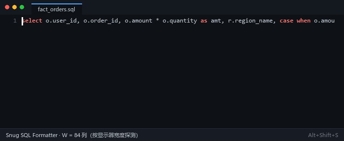
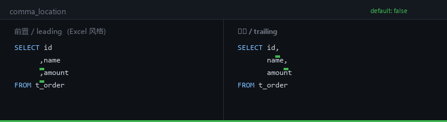
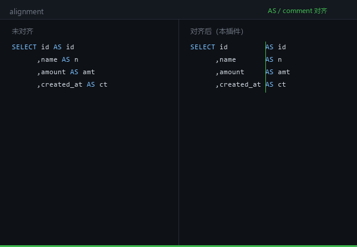

<h1 align="center">Snug SQL Formatter</h1>

<p align="center">
  按屏幕宽度自动折行的 SQL / HQL / DDL 格式化器
</p>

<p align="center">
  Screen-width-aware SQL formatter for VS Code — wraps at W × 80% and snaps to
  complete logical blocks.
</p>

<div align="center">

</div>

---

## 安装 Installation

从 VS Code Marketplace 安装，或下载 `.vsix` 后执行 `code --install-extension <file>.vsix`。

Install from the Marketplace, or install a `.vsix` with `code --install-extension <file>.vsix`.

---

## 特点 Features

### 1. 按屏幕宽度折行 / Screen-width wrapping

一行超过屏幕宽度 W 的 **80%** 就折行，折行点**向前或向后舍入到完整逻辑块的边界**：

- `price * cnt` 不会被拆成 `price` / `* cnt`；
- `expr AS 别名` 不会被甩开，只要整项（含别名）仍能塞进 W 的 100%；
- `CASE WHEN … END` 作为一个整体参与折行决策。

宽度来源（优先级从高到低）：

| 配置 | 作用 |
|---|---|
| `snugSql.screen_width` | 显式指定列数 W，**跨机器结果一致** |
| `snugSql.max_line_length` | 硬上限，等价于手动指定 W |
| `snugSql.detectScreenWidth` | `true`（默认）时启动探测一次显示器宽度，多屏取最宽 |

探测不到时依次回落到 `editor.wordWrapColumn` → 120 列。想在所有机器上排出完全一致的宽度，
把 `detectScreenWidth` 设为 `false` 并显式设置 `screen_width`。

> 探测记录的是**像素宽度**，可见列数按当前 `editor.fontSize` 实时换算 ——
> 同一台机器上改字号会立刻生效。但不同机器、不同显示器之间的像素宽度本来就不同，
> 所以**跨机器一致只能靠显式配置**（`screen_width` / `max_line_length`），
> 默认的自动探测只能保证"跟着你这块屏走"。运行中改动这三项配置会自动重新探测。

### 2. DDL 格式化 / DDL formatting

`Shift+Alt+L`。对标准 `CREATE TABLE` 语法通用，Hive / Spark / MySQL / PostgreSQL
的类型与约束都能处理，不限于 Hive。

### 3. 从 INSERT 反推建表 DDL / Extract DDL from INSERT

`Shift+Alt+;`。目标表名支持 `db.table`、`"my schema"."order"`、`` `my table` ``、`[my table]`；
类型推断覆盖 CAST / 字面量 / 聚合函数；`array(1,2)` / `map(...)` / `named_struct(...)`
按方言给出真实集合类型（Hive 系 `ARRAY<BIGINT>`，PG 系 `BIGINT[]` / `JSONB`）。
推断不出类型的列会列在 DDL 末尾让你核对，不会静默当 `STRING`；
SELECT 含通配符时会附提示说明哪些列需要手工展开。

**结果输出到新的未命名文档，原文件不被修改。** 多条 INSERT 时每条目标表各生成一条
`CREATE TABLE`；`INSERT … PARTITION (dt=…)` 写成 `PARTITIONED BY (dt STRING)`。

### 4. 逗号位置 / Comma location

`comma_location` 控制逗号前置还是后置，两种风格都能保持列对齐：

<div align="center">

</div>

### 5. AS / 注释对齐 / Alignment

按显示宽度（CJK 字符算 2 列）补齐空格，让 `AS` 别名和行尾注释形成整齐的一列：

<div align="center">

</div>

---

## 配置 Configuration

文件 → 首选项 → 设置 → 扩展 → Snug SQL Formatter。共 11 项，常用：

| 配置 | 默认 | 说明 |
|---|---|---|
| `snugSql.uppercase` | `true` | 关键字转大写 |
| `snugSql.comma_location` | `false` | `true` = 逗号放行尾，`false` = 放行首（SELECT 与 DDL 列清单一致） |
| `snugSql.bracket_char` | `false` | 子查询/DDL 缩进用空格代替 Tab |
| `snugSql.dialect` | `"auto"` | 方言，用于消解 `#` 等词法歧义 |
| `snugSql.as_loc_cnt` | `0` | `AS` 对齐的最大列（0 = 跟随行宽） |
| `snugSql.screen_width` | `0` | 显式屏幕列数 W（0 = 自动探测） |
| `snugSql.max_line_length` | `0` | 硬上限列数 |
| `snugSql.cjk_width` | `1.81818` | 一个汉字相对 ASCII 的渲染宽度 |
| `snugSql.detectScreenWidth` | `true` | 启动时探测显示器宽度 |

配置项也可以写在语言级：`"[sql]": { "snugSql.uppercase": false }`。

---

## 诊断 / Lint — 在问题点标出错误与不规范写法

格式化时顺带检查，结果进 VS Code 的「问题」面板（`Ctrl+Shift+M`），波浪线落在**出错的那个字符**上。
默认开启，可用 `snugSql.lint.enabled` 关掉，或用 `snugSql.lint.disabledRules` 静音个别规则。

命令面板执行 `Snug SQL Formatter: Re-check SQL` 可手动重跑一次。

### 规则表

| 规则 id | 级别 | 说明 |
|---|---|---|
| `syntax.unbalanced-paren` | error | 括号不配对 |
| `syntax.unterminated-string` | error | 字符串未闭合 |
| `syntax.unterminated-comment` | error | 块注释未闭合（`/*` 之后没有 `*/`） |
| `syntax.trailing-comma` | error | 列表末尾多余的逗号（BigQuery / DuckDB 的 SELECT 列表除外） |
| `syntax.clause-order` | error | 子句顺序错误（WHERE 在 FROM 前等） |
| `syntax.duplicate-clause` | error | 同一条查询里出现两次相同子句 |
| `syntax.reserved-alias` | error | 保留字被直接用作别名 |
| `syntax.empty-in-list` | error | `IN ()` 空列表 |
| `danger.null-comparison` | warning | 用 `=` / `<>` / `!=` 比较 NULL |
| `danger.delete-update-no-where` | warning | `DELETE` / `UPDATE` 没有 `WHERE` |
| `danger.cartesian-product` | warning | 多表逗号连接且没有 `WHERE` |
| `danger.not-in-subquery` | warning | `NOT IN` 接子查询（遇到 NULL 会返回空集） |
| `danger.join-without-on` | warning | `JOIN` 缺少 `ON` / `USING` |
| `danger.and-or-mixed` | warning | `AND` 与 `OR` 混用且没有括号 |
| `style.select-star` | warning | `SELECT *` |
| `style.implicit-join` | info | 隐式连接（`FROM a, b WHERE …`） |
| `style.leading-wildcard-like` | info | `LIKE` 以通配符开头（用不上索引） |
| `style.union-vs-union-all` | info | `UNION` 没加 `ALL` |
| `style.order-by-ordinal` | info | 按列序号排序 / 分组 |
| `style.distinct-with-groupby` | info | `DISTINCT` 与 `GROUP BY` 同时出现 |

### 设计取向：宁可漏报，不可误报

一条动不动就亮的波浪线，用户第一件事就是把整个功能关掉。所以每条规则都只在
**文本本身足以证明**问题时才开火：

- `EXISTS (SELECT *)` 是惯用法，不报 `SELECT *`；
- `CROSS JOIN` / `NATURAL JOIN` / `ARRAY JOIN` 本来就不需要 `ON`，不报；
- 子句顺序只在**括号深度 0** 判定 —— 子查询有自己的完整子句序列；
- `IS NULL` / `IS NOT NULL` 不报；括号内的 `OR` 混用不报；
- `LIKE 'abc%'`（后缀通配）不报，只有前置通配才报。

诊断与格式化**共用同一个词法器**，所以 `#` 是注释还是异或、反斜杠算不算转义、
`$$…$$` 到哪里结束，两边的判断必然一致，波浪线不会落到错误的字符上。

---

## 安全网 Safety net

格式化结果必须与原文 **token 等价**，否则原样返回。整篇不通过时会先按语句隔离，
只把出问题的那条保留原文，其余照常排版。因此不会改坏代码；
如果某段没有格式化，状态栏会说明原因（非 SQL / 括号不配对 / 安全网回退 / 内核异常）。

The formatter verifies token equivalence and falls back to the original text
statement-by-statement when a check fails, so it never silently corrupts code.

---

## 已知边界 Known limits

以下情况会**故意**超出宽度，不是 bug：

- 单个超长 token（如一个很长的字符串或标识符）；
- 行尾注释本身长于一行；
- 链式算术为了让运算符留在行首而略微超宽。

---

## 快捷键 Keybindings

| 快捷键 | 命令 |
|---|---|
| `Shift+Alt+F` | VS Code 内置的格式化（首次需在「选择格式化程序」里选本扩展） |
| `Alt+Shift+S` | `Snug SQL Formatter: Beautify SQL` |
| `Alt+Shift+L` | `Snug SQL Formatter: Beautify SQL DDL` |
| `Alt+Shift+;` | `Snug SQL Formatter: Extract SQL DDL` |
| —（命令面板） | `Snug SQL Formatter: Re-check SQL` — 手动重跑诊断 |

`Shift+Alt+F` 是 VS Code **内置**的格式化快捷键，本扩展通过注册
`DocumentFormattingEditProvider` / `DocumentRangeFormattingEditProvider` 接入它，
不额外占用键位。

---

## 开发 Development

```bash
npm test            # 271 条回归（格式化 / 诊断规则 / 接入层 / 异步与复核组）
node --check src/kernel.js
```

代码结构：

```
extension.js        VS Code 集成层（配置读取、命令、范围格式化、诊断接入）
src/kernel.js       格式化内核（词法器 → 子句状态机 → 折行 → 对齐）
src/lint.js         诊断引擎（20 条规则，纯函数，共用内核词法器）
probe.ps1           显示器宽度探测（仅 Windows）
test/run.js         回归套件
```

诊断引擎是**纯函数**：`lint(text, opts)` → `{ ok, issues }`，不碰 VS Code API，
因此可以单独跑、单独测，也能给别的工具复用。接入层（防抖、指纹、诊断集合）
在 `extension.js`。

---

## 设计参考 Design references

排版行为（宽度 + 分组模型、逗号位置风格、`AS` 对齐规则）参考了 Prettier、sql-formatter、
sqlfluff 等公开项目的**行为**；关键字表来自 SQL 标准与各数据库厂商文档（事实性内容）。

格式内核与接入层衍生自 MIT 许可的 **SQL Beautify**（Clark Yu），并做了大幅修改，
上游版权声明见 [NOTICE.md](NOTICE.md)。

---

## 许可 License

[MIT](LICENSE.txt) © 2026 zkcoding

本项目包含衍生自 SQL Beautify 的代码（MIT © 2019 Clark Yu），
完整的上游许可文本与衍生范围见 [NOTICE.md](NOTICE.md)。

